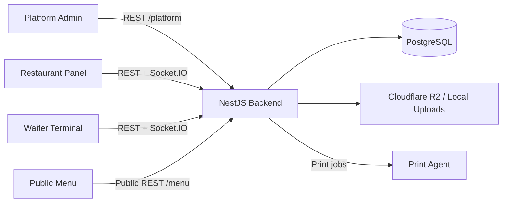
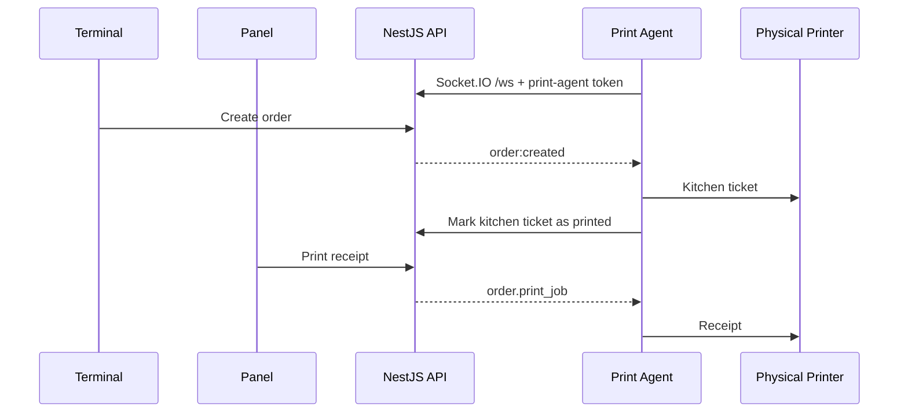

# Corder

> [Türkçe](README.tr.md)

Corder is a multi-tenant POS and management system I developed for restaurant operations.

The platform covers restaurant setup, digital menu, table and check management, order taking, cash register, inventory, staff, campaigns, reporting, and printing workflows.

## Technical scope

The codebase includes NestJS modules, TypeORM migrations, PostgreSQL tenant isolation, JWT authentication, and real-time synchronization via Socket.IO. Concurrent access to table sessions is controlled with pessimistic locking. The backend runs with Docker Compose and nginx; files can be stored on Cloudflare R2. Frontends are split into independent Vite applications that can be deployed to Cloudflare Pages. Kitchen and receipt printing is handled by the Windows `print-agent` service in this repository.

## Applications


| Application                | User                | Description                                                              | Default port |
| -------------------------- | ------------------- | ------------------------------------------------------------------------ | ------------ |
| `corder-admin-frontend`    | Platform admin      | Restaurant, root admin, terminal account, and print-agent token management | `3003`       |
| `corder-panel-frontend`    | Restaurant manager  | Table, payment, cash register, product, inventory, staff, campaign, and report management | `3001`       |
| `corder-terminal-frontend` | Waiter / terminal   | Staff selection, table locking, ordering, check transfer, and receipt printing | `3000`       |
| `corder-menu-frontend`     | Restaurant customer | Public digital menu, product search, campaigns, and contact information  | `3002`       |
| `corder-backend`           | All clients         | REST API, Socket.IO, authentication, business rules, and data access     | `4000`       |
| `print-agent`              | Restaurant POS PC   | Windows Node.js service: Socket.IO + HTTP sync, ESC/POS kitchen/receipt printing | —            |


## Architecture




The backend is a modular NestJS monolith:

- `PlatformModule`: Platform admin, restaurant, and root admin operations
- `RestaurantModule`: Tables, orders, cash register, inventory, staff, printers, and restaurant settings
- `MenuModule`: Public digital menu queries
- `OrdersGateway`: Restaurant-scoped Socket.IO events

Restaurant data is isolated in PostgreSQL via `restaurant_id`.

## Technology stack

### Frontend

- React 19
- TypeScript 5.7
- Vite 6
- Tailwind CSS 4
- Socket.IO Client (panel and terminal)
- Recharts (panel)
- pnpm

### Backend

- Node.js 20
- NestJS 10
- TypeORM 0.3
- PostgreSQL 16
- Socket.IO
- JWT + Passport
- Cloudflare R2 / S3 API
- Docker Compose and nginx

## Requirements

- Node.js 20+
- pnpm
- Docker and Docker Compose

> This repository is not yet a pnpm workspace. Dependencies must be installed separately in each application folder.

## Local development

### 1. Backend

```bash
cd corder-backend
cp .env.example .env
pnpm install
./start-dev.sh
```

`start-dev.sh` starts the development PostgreSQL service with Docker and runs the NestJS API in development mode.

Alternatively, if PostgreSQL is already running:

```bash
cd corder-backend
pnpm install
pnpm run start:dev
```

API: [http://localhost:4000](http://localhost:4000)  
Health check: [http://localhost:4000/health](http://localhost:4000/health)

### 2. Frontends

Each frontend should be run in a separate terminal:

```bash
cd corder-terminal-frontend
printf 'VITE_API_URL=http://localhost:4000\n' > .env.local
pnpm install
pnpm run dev
```

```bash
cd corder-panel-frontend
printf 'VITE_API_URL=http://localhost:4000\n' > .env.local
pnpm install
pnpm run dev
```

```bash
cd corder-menu-frontend
printf 'VITE_API_URL=http://localhost:4000\n' > .env.local
pnpm install
pnpm run dev
```

```bash
cd corder-admin-frontend
printf 'VITE_API_URL=http://localhost:4000\n' > .env.local
pnpm install
pnpm run dev
```

Local URLs:

- Terminal: [http://localhost:3000](http://localhost:3000)
- Panel: [http://localhost:3001](http://localhost:3001)
- Menu: `http://localhost:3002?restaurant=RESTAURANT_SLUG`
- Platform admin: [http://localhost:3003](http://localhost:3003)

## Running locally with Docker

The backend supports two Docker usage scenarios.

### Option A - PostgreSQL only in Docker

For development, I run PostgreSQL in a container and NestJS on the host in watch mode:

```bash
cd corder-backend
cp .env.example .env
pnpm install
docker compose -f docker-compose.dev.yml up -d
pnpm run start:dev
```

`docker-compose.dev.yml` comes with these settings:

- Uses the `postgres:16-alpine` image.
- Exposes PostgreSQL on port `5432` on the host.
- Persists data in the `pgdata_dev` named volume.
- Applies a container health check with `pg_isready`.
- Preserves NestJS hot reload.

To check container status and logs:

```bash
docker compose -f docker-compose.dev.yml ps
docker compose -f docker-compose.dev.yml logs -f db
```

To stop the development database:

```bash
docker compose -f docker-compose.dev.yml down
```

To start completely fresh by also removing the database volume:

```bash
docker compose -f docker-compose.dev.yml down -v
```

> `-v` permanently deletes existing local database data.

### Option B - Full backend stack in Docker

To test the production topology locally, API, nginx, and PostgreSQL can be started together:

```bash
cd corder-backend
cp .env.production.example .env
```

Change the example secret and password values in `.env`:

```bash
openssl rand -hex 32
openssl rand -hex 32
```

Then build and start the stack:

```bash
docker compose up -d --build
```

Service status:

```bash
docker compose ps
docker compose logs -f api
docker compose logs -f nginx
docker compose logs -f db
```

In this compose setup:

- nginx listens on port `80` on the host.
- The NestJS API runs only on port `4000` inside the Docker network.
- PostgreSQL is not exposed to the host; only the API container can access it.
- The API does not start until PostgreSQL is ready; the `service_healthy` condition is used.
- Upload files are stored in the `api_uploads` named volume.
- PostgreSQL data is persisted in the `pgdata` named volume.

Verify the API through nginx:

```bash
curl http://localhost/health
```

To stop the stack:

```bash
docker compose down
```

To completely remove containers and production-like local data:

```bash
docker compose down -v
```

### Dockerfile structure

`corder-backend/Dockerfile` uses a two-stage build:

1. **Builder stage**
   - Uses `node:20-alpine` as the base.
   - Enables pnpm via Corepack.
   - Performs deterministic dependency installation with the lockfile.
   - Compiles the NestJS application into the `dist/` folder.
2. **Runtime stage**
   - Installs only production dependencies.
   - Copies only the compiled `dist/` output from the builder stage.
   - Defines `/app/uploads` as a persistent volume.
   - Runs the application with `node dist/main.js`.

Build tools and development dependencies are not copied into the final image. The runtime image contains only the compiled application and production dependencies.

Frontends have no Dockerfile. Since Vite outputs are static, deploying them via Cloudflare Pages is more practical than running separate containers. In local development, frontends are run with pnpm.

## Initial setup flow

1. Set `PLATFORM_ADMIN_EMAIL` and `PLATFORM_ADMIN_PASSWORD` in the backend `.env` file.
2. When the backend starts, the platform admin is created automatically.
3. Log in through the platform admin interface.
4. Create a new restaurant.
5. Define a root admin account for the restaurant.
6. Set the terminal email/password and, if needed, the print-agent token.
7. On the restaurant POS PC, install [`print-agent/`](print-agent/) with that token and register a boot cron / scheduled task so it starts automatically (see Printing system below).
8. With the root admin account, create categories, products, staff, sections, and tables from the panel.
9. Log in with the terminal account and use the order flow.
10. Open the digital menu with the restaurant slug.

## Core workflows

### Orders

1. The terminal logs in with the restaurant account.
2. A waiter is selected and, if required, the PIN is verified.
3. The table is locked via the server-side session-lock mechanism.
4. An order is created by adding products to the cart.
5. The order is broadcast to the panel and other terminals via Socket.IO.
6. A kitchen or receipt print job is sent to the print-agent.
7. Payment is completed from the panel; table, cash register, and completed order records are updated.

### Cash register and payments

An open cash register shift is required for order and payment operations. The system supports cash, card, meal card, Multinet, discount, tip, and credit (tab) records.

### Inventory

Ingredients, suppliers, stock movements, purchase orders, and inventory counts are managed from the panel. Product recipes are stored as JSON.

## Printing system

Browser applications do not connect directly to printers. The terminal and panel send print requests to the backend; a separate print-agent running at the restaurant receives the job and forwards it to the physical printer. This way, the printer does not need to be accessible from the browser over USB, network, or Bluetooth.



### Print-agent identity

Each restaurant has a separate `print_agent_token` value. The token is created per restaurant from the platform admin interface and given to the print-agent.

The agent uses the same token on two channels:

- Socket.IO connection `/ws` handshake token
- HTTP fallback requests with `Authorization: Bearer PRINT_AGENT_TOKEN`

The backend matches the token to the restaurant record and admits the agent only to that restaurant's Socket.IO room. The print-agent token is a long-lived credential; it must not be added to Git or shared across restaurants.

### Kitchen ticket

When a new order is created, the backend broadcasts an `order:created` event to the restaurant room. The event includes:

- Order and table information
- Waiter name
- Product, quantity, price, and notes
- Product and category IDs

Category IDs can be used on the agent side to route to kitchen, bar, or other department printers.

An HTTP fallback exists so kitchen tickets are not lost when the WebSocket connection drops:

```http
GET /restaurant/print-agent/pending-kitchen-orders
Authorization: Bearer PRINT_AGENT_TOKEN
```

This endpoint returns the oldest 100 orders that are in active status and have an empty `kitchen_ticket_printed_at` field. After printing, the agent acknowledges the order:

```http
PATCH /restaurant/print-agent/orders/ORDER_ID/kitchen-printed
Authorization: Bearer PRINT_AGENT_TOKEN
```

On acknowledgment, `kitchen_ticket_printed_at` is updated and the same order does not appear in subsequent fallback queries. When the agent restarts, it can first fetch pending orders and then listen for Socket.IO events.

### Check and receipt printing

The terminal or panel creates a receipt job via the following endpoint:

```http
POST /restaurant/orders/print-receipt
Authorization: Bearer RESTAURANT_JWT
Content-Type: application/json
```

There are two receipt modes:

- `split`: Single check or category-based output. Line notes are preserved.
- `consolidated`: Combines active orders on the table into a single receipt. Lines with the same product and unit price are merged; line notes are removed.

The request can print a single check with `orderId`, all active orders on a table with `tableId`, or quick-sale lines directly with `items`. The backend prepares totals and category information and sends it to the agent as an `order.print_job` Socket.IO event.

When a product is cancelled, a `kitchen_cancel` job is produced on the same channel. This job includes table, waiter, cancelling staff, cancellation reason, and product information.

### Printer records

The `restaurant_printer_configs` table in the backend stores:

- Printer name and type (e.g. `thermal`, `kitchen`, `bar`)
- Connection type (`usb`, `network`, `bluetooth`)
- IP address and port for network printers
- Department
- Status (`online`, `offline`, `error`)
- Paper width, default `80`
- Auto-cut setting

These records are for printer inventory and routing configuration. Physical printing is performed by the print-agent on the restaurant network, not by the NestJS container.

### Print agent application (`print-agent/`)

The restaurant-side agent lives in this repository under [`print-agent/`](print-agent/). It is a Node.js service (typically on Windows 10 at the POS PC) that stays connected to the backend even when the browser/PWA is closed.

**What it does**

- Connects to Socket.IO at `/ws` with `AGENT_TOKEN` (the restaurant `print_agent_token`)
- Listens for `order:created` (kitchen tickets) and `order.print_job` (receipts / cancel jobs)
- Builds ESC/POS tickets and sends them to a USB (Windows spooler RAW) or network (`host:port`) thermal printer
- Queues failed jobs on disk and retries; polls pending kitchen orders over HTTP when WebSocket drops
- Can split one order across multiple printers by category (`PRINT_CATEGORY_ROUTES` / `PRINT_CATEGORY_NETWORK`)

**Quick setup**

```bash
cd print-agent
npm install
copy .env.example .env
```

Fill at least:

- `BACKEND_WS_URL` — API origin (e.g. `https://api.example.com`)
- `BACKEND_SOCKET_PATH` — usually `/ws`
- `AGENT_TOKEN` — print-agent token from the platform admin restaurant screen
- `RESTAURANT_ID` — restaurant id (prefer the real id over `*`)
- `PRINTER_MODE` — `command` (USB / Windows printer name) or `network_raw` (TCP 9100)
- `PRINTER_NAME` — exact Windows printer name when using `command` mode

Start:

```bash
npm start
```

For USB on Windows, `PRINT_COMMAND` runs `scripts/send-raw-printer.ps1` in spooler RAW mode. Prefer Ethernet + `PRINTER_MODE=network_raw` when possible for more reliable delivery.

**Recommended: auto-start on boot (cron / scheduled job)**

Do not start the agent manually after every reboot. Register it so the POS PC launches print-agent at startup:

- **Linux / macOS:** cron `@reboot` that `cd`s into `print-agent` and runs `npm start` (or `node src/index.js`)
- **Windows:** Task Scheduler “At startup” / “At log on” (Windows equivalent of boot cron); NSSM service is an optional alternative

Details and example crontab / Task Scheduler commands are in [`print-agent/README.md`](print-agent/README.md) ([Türkçe](print-agent/README.tr.md)).

### Operational notes

- nginx forwards WebSocket upgrade headers for `/ws` to the backend.
- The agent can authenticate with the print-agent token instead of JWT during connection.
- Kitchen orders have database-backed fallback and printed acknowledgment.
- Check and cancellation jobs are currently sent via Socket.IO; the HTTP fallback used for kitchen orders does not apply to these job types.
- The same agent can route to multiple physical printers by category or department.
- Prefer a boot cron / scheduled task so the agent comes back online after power loss or OS restart.

## Authentication

The system has three primary identity types:

- Platform admin JWT
- Restaurant root admin / terminal JWT
- Print-agent bearer token

JWT keys and initial accounts are managed via backend environment variables. Example or default secret values must not be used in production.

## Environment variables

Core variables for the backend:

```dotenv
NODE_ENV=development
PORT=4000

DB_HOST=localhost
DB_PORT=5432
DB_USERNAME=corder
DB_PASSWORD=corder_secret
DB_NAME=corder

JWT_SECRET=change-me
JWT_EXPIRES_IN=7d
PLATFORM_JWT_SECRET=change-me-too
PLATFORM_ADMIN_EMAIL=admin@example.com
PLATFORM_ADMIN_PASSWORD=change-me

CORS_ORIGIN=http://localhost:3000,http://localhost:3001,http://localhost:3002,http://localhost:3003
```

To store file uploads on Cloudflare R2, these additional variables can be used:

```dotenv
R2_ACCOUNT_ID=
R2_ACCESS_KEY_ID=
R2_SECRET_ACCESS_KEY=
R2_BUCKET_NAME=
R2_PUBLIC_BASE_URL=
```

All frontends receive the backend address as a build-time variable:

```dotenv
VITE_API_URL=http://localhost:4000
```

For all options, see:

- `corder-backend/.env.example`
- `corder-backend/.env.production.example`
- `.env.production.example` files in the frontends

## Cloudflare R2 Object Storage

Product and campaign images uploaded from the panel can be stored on Cloudflare R2. The backend uses the S3-compatible API of R2 via the AWS SDK for JavaScript.

### Why R2?

- Standard AWS SDK usage thanks to S3-compatible API
- Images stored independently of the application server
- Cloudflare custom domain and CDN cache support
- No file loss when the backend container is recreated
- Tenant-based object key structure
- Low operational cost for public images

### Object key structure

Uploaded files are separated by restaurant slug:

```text
RESTAURANT_SLUG/menu/TIMESTAMP-RANDOM_SUFFIX.webp
```

Example:

```text
demo-restoran/menu/1784155200000-a1b2c3d4.webp
```

The backend:

- Accepts only `jpeg`, `png`, `gif`, and `webp`.
- Limits file size to 5 MB.
- Reads the file in memory and uploads it directly to R2.
- Preserves `Content-Type` on the object.
- Adds `Cache-Control: public, max-age=31536000, immutable`.
- Returns the public object URL after a successful upload.

Since file names are generated uniquely, long-term immutable cache can be used safely.

### 1. Creating an R2 bucket

Via the Cloudflare Dashboard:

1. Open **Storage & Databases > R2 Object Storage**.
2. Click **Create bucket**.
3. Create a bucket named, for example, `corder-uploads`.
4. Choose the location and storage class as needed.

Alternative setup with Wrangler:

```bash
npx wrangler login
npx wrangler r2 bucket create corder-uploads
npx wrangler r2 bucket list
```

### 2. Creating an R2 API token

1. Go to **Manage API Tokens** on the R2 Overview screen.
2. Choose **Create Account API token** or **Create User API token**.
3. Grant **Object Read & Write** permission.
4. Restrict the token to the `corder-uploads` bucket only, not all buckets.
5. Save the generated `Access Key ID` and `Secret Access Key` values securely.

The secret key may not be viewable again later. These values must not be added to frontend environment variables or the Git repository.

R2 S3 endpoint format:

```text
https://ACCOUNT_ID.r2.cloudflarestorage.com
```

The backend builds the endpoint automatically from `R2_ACCOUNT_ID`.

### 3. Connecting a public custom domain

In production, use a custom domain instead of the `r2.dev` development URL:

1. Open the **Settings** tab inside the R2 bucket.
2. Go to **Public access > Custom Domains > Connect Domain**.
3. Connect a domain such as `cdn.example.com`.
4. Confirm the DNS record Cloudflare creates.
5. Test bucket access through this URL.

Example:

```dotenv
R2_PUBLIC_BASE_URL=https://cdn.example.com
```

Cloudflare Cache, WAF, access control, and bot management features can be used via the custom domain. The `r2.dev` address is for development and testing.

### 4. Backend environment variables

In the server's `corder-backend/.env` file:

```dotenv
R2_ACCOUNT_ID=cloudflare-account-id
R2_ACCESS_KEY_ID=r2-access-key-id
R2_SECRET_ACCESS_KEY=r2-secret-access-key
R2_BUCKET_NAME=corder-uploads
R2_PUBLIC_BASE_URL=https://cdn.example.com
```

The Compose file passes these variables to the API container. The following message should appear in container logs:

```text
R2 upload enabled (bucket=corder-uploads)
```

If any of the five values is missing, R2 is disabled and the backend falls back to the local `/uploads` folder:

```text
R2 upload disabled ... Falling back to local /uploads
```

With Docker, local uploads are stored in the `api_uploads` volume. R2 can be used in production and local fallback in development.

### 5. R2 cache settings

Newly uploaded objects are created with cache headers. To update headers for previously uploaded objects:

```bash
cd corder-backend
node --env-file=.env scripts/r2-set-cache-headers.mjs
```

The script:

- Lists all objects in the bucket with pagination.
- Reads each object's current `Content-Type` value.
- Refreshes metadata by copying the object onto itself.
- Applies a one-year immutable cache header.

If all file types should be cached on the custom domain, a **Cache Everything** rule can be defined in Cloudflare Cache Rules for the relevant hostname. If changes are not visible, cache purge should be applied for the relevant hostname/object.

### R2 CORS note

The browser does not upload directly to R2. The file first goes to an authenticated NestJS endpoint, then is written to R2 by the backend. R2 CORS configuration is not required for this flow.

If direct browser upload via presigned URLs is implemented later, the bucket CORS policy should be restricted to allow only known panel origins.

## Database

The production schema is managed with TypeORM migrations, and migrations run automatically on backend startup by default. Setting `SKIP_MIGRATIONS_ON_START=true` disables this behavior.

Migration files are under `corder-backend/src/migrations`. The project does not currently define a package script for running migrations manually. See [DATABASE.md](corder-backend/docs/DATABASE.md) for detailed database notes.

## Build

Each package is built in its own folder:

```bash
pnpm run build
```

Frontend outputs go to `dist/`; the backend output is also written to `dist/`.

## Production setup on a server with Docker

### 1. Server preparation

The server should have:

- Git
- Docker Engine
- Docker Compose plugin
- Domain/DNS access
- Sufficient disk for Docker images and PostgreSQL data at minimum

Install Docker according to your distribution's official Docker Engine documentation. Verify the installation:

```bash
docker --version
docker compose version
docker run --rm hello-world
```

### 2. Clone the repository on the server

Example directory:

```bash
sudo mkdir -p /opt/corder
sudo chown "$USER":"$USER" /opt/corder
git clone YOUR_GIT_REPOSITORY_URL /opt/corder
cd /opt/corder/corder-backend
```

### 3. Create the production environment

```bash
cp .env.production.example .env
chmod 600 .env
```

Generate strong secrets:

```bash
openssl rand -hex 32
openssl rand -hex 32
openssl rand -base64 36
```

Fill at least these fields in `.env` with production values:

- `DB_PASSWORD`
- `JWT_SECRET`
- `PLATFORM_JWT_SECRET`
- `PLATFORM_ADMIN_EMAIL`
- `PLATFORM_ADMIN_PASSWORD`
- `CORS_ORIGIN`
- All `R2_*` values if used

Production CORS example:

```dotenv
CORS_ORIGIN=https://panel.example.com,https://terminal.example.com,https://menu.example.com,https://admin.example.com
```

### 4. Start the stack

```bash
cd /opt/corder/corder-backend
docker compose build --pull
docker compose up -d --remove-orphans
docker compose ps
```

Check the initial startup logs:

```bash
docker compose logs -f api
```

In production, TypeORM migrations run automatically on API startup. A database backup should be taken before deployment, and traffic should not be opened until migrations complete.

Health check:

```bash
curl --fail http://127.0.0.1/health
```

Update:

```bash
cd /opt/corder
git fetch origin main
git checkout main
git pull --ff-only origin main
cd corder-backend
docker compose build --pull
docker compose up -d --remove-orphans
```

### 5. DNS, Cloudflare proxy, and TLS

The current nginx configuration listens for the `api.example.com` hostname and only HTTP port `80` on the host. For production:

1. Create the API subdomain in Cloudflare DNS.
2. Point the A/AAAA record to the server IP.
3. Enable Cloudflare proxy.
4. Verify that API and `/ws` traffic passes through.
5. Add TLS on the origin side and use Cloudflare SSL/TLS mode **Full (strict)**.

Since the current repository does not include `443`/TLS configuration on the origin, a Cloudflare Origin Certificate, Let's Encrypt, or another TLS-terminating reverse proxy/load balancer should be added to nginx before production. Cloudflare **Flexible** mode is not recommended as a secure production solution; it does not encrypt traffic between Cloudflare and the origin.

For WebSockets, nginx:

- Passes `Upgrade` and `Connection` headers.
- Routes `/ws` requests to the API container.
- Uses `proxy_read_timeout 86400` for long-lived connections.

## CI/CD pipeline

The current backend pipeline:

```text
push main
  -> GitHub Actions
  -> appleboy/ssh-action
  -> production server
  -> git fetch/reset
  -> docker compose build --pull
  -> docker compose up -d
  -> prune old images
```

The workflow:

- Triggers on push to `main` or manual `workflow_dispatch`.
- Runs only one deployment at a time.
- Cancels an in-progress older deployment when a new one starts.
- Uses a GitHub-hosted Ubuntu runner.
- Connects to the server with an SSH private key.
- Stops the script on error.

Required GitHub repository settings:

### Variables

```text
DEPLOY_HOST
DEPLOY_USER
DEPLOY_REPO_ROOT
```

### Secrets

```text
DEPLOY_SSH_KEY
```

> Monorepo note: The current workflow is under `corder-backend/.github/workflows`, while the deploy script assumes the repository root is the backend. For GitHub Actions workflows to run, the workflow should be moved to the root `.github/workflows` directory; the remote script should be updated to run compose under `/opt/corder/corder-backend`.

Recommended pipeline quality gates:

1. Dependency installation (`pnpm install --frozen-lockfile`)
2. TypeScript typecheck
3. Lint
4. Unit and integration tests
5. NestJS production build
6. Docker image build
7. Migration smoke test
8. Deployment
9. `/health` and `/ws` smoke test
10. Rollback on failure

## Frontend deployment with Cloudflare Pages

All four frontends are static Vite SPAs. Each is deployed as a separate Cloudflare Pages project:

| Pages project   | Root directory              | Build command     | Output directory | Recommended domain    |
| --------------- | --------------------------- | ----------------- | ---------------- | --------------------- |
| Corder Admin    | `corder-admin-frontend`     | `pnpm run build`  | `dist`           | `admin.example.com`   |
| Corder Panel    | `corder-panel-frontend`     | `pnpm run build`  | `dist`           | `panel.example.com`   |
| Corder Terminal | `corder-terminal-frontend`  | `pnpm run build`  | `dist`           | `terminal.example.com`|
| Corder Menu     | `corder-menu-frontend`      | `pnpm run build`  | `dist`           | `menu.example.com`    |

### Creating a Pages project

For each frontend:

1. Go to **Workers & Pages** in the Cloudflare Dashboard.
2. Choose **Create application > Pages > Import an existing Git repository**.
3. Connect this monorepo's GitHub repository.
4. Select **React (Vite)** as the framework preset.
5. Set the relevant frontend folder as **Root directory (advanced)**.
6. Enter `pnpm run build` in the Build command field.
7. Set the Build output directory to `dist`.
8. Select `main` as the production branch.
9. Add the production API URL to Environment variables:

```dotenv
VITE_API_URL=https://api.example.com
```

10. Start the first deployment.

Cloudflare Pages detects dependency installation from the lockfile. If needed, pin the Node version under Pages environment variables to match the project standard:

```dotenv
NODE_VERSION=20
```

Since each frontend has its own `pnpm-lock.yaml` file, the root directory setting is required.

### Monorepo build watch paths

To avoid unnecessary builds, each Pages project is given its own folder as a build watch path:

```text
corder-admin-frontend/**
corder-panel-frontend/**
corder-terminal-frontend/**
corder-menu-frontend/**
```

Each project should watch only its own path. If a shared package folder is added later, the relevant shared path should be added to all dependent Pages projects.

### Preview deployments

Cloudflare Pages can generate preview URLs for branches and pull requests other than the production branch. Recommended flow:

1. Open a feature branch.
2. Create a pull request.
3. Pages produces a preview deployment for the relevant frontend.
4. If the API is needed, add the preview origin to the backend `CORS_ORIGIN` list in a controlled way.
5. After review, merging to `main` triggers the production deployment.

Backend CORS configuration does not directly support wildcard preview domains; if many dynamic preview URLs will be used, the origin validation strategy should be designed separately.

### Connecting a custom domain

For each Pages project:

1. Go to **Custom domains > Set up a custom domain**.
2. Enter the relevant subdomain.
3. If the Cloudflare zone is in the same account, the DNS record is created automatically.
4. Wait for the SSL certificate to become active.
5. Add the domain to the backend `CORS_ORIGIN` value.
6. Re-run the frontend deployment.

Recommended domain layout:

```text
api.example.com       -> Docker/NestJS backend
admin.example.com     -> Cloudflare Pages
panel.example.com     -> Cloudflare Pages
terminal.example.com  -> Cloudflare Pages
menu.example.com      -> Cloudflare Pages
cdn.example.com       -> Cloudflare R2 custom domain
```

### SPA route behavior

When `404.html` is not present at the root of the build output, Cloudflare Pages automatically treats applications like React as SPAs and serves unknown paths via `index.html`. React Router routes such as `/login` and `/dashboard/*` in the admin application benefit from this behavior.

The current applications do not require an additional `_redirects` file. If a root `404.html` is added to the output later, SPA fallback behavior should be verified again.

### Pages cache and environment notes

- `VITE_*` variables are not runtime secrets; they are embedded into the JavaScript bundle at build time.
- `VITE_API_URL` must not contain sensitive information.
- Different API URLs can be defined for Production and Preview environments.
- Hashed Vite assets are suitable for long-term caching.
- `index.html` should remain on short cache behavior so the latest deployment can be picked up quickly.
- Cloudflare Pages provides automatic TLS, CDN distribution, immutable deployments, and rollback capability.

## Known gaps

These items are known gaps in the current version and will be addressed incrementally in future updates.

- No automated test infrastructure in the packages.
- Missing shared ESLint configuration for frontend lint scripts.
- Insufficient backend role-based authorization coverage.
- Part of staff PIN verification is performed on the terminal client.
- Offline mode on the terminal does not provide a real offline order queue.
- The backup API does not produce a real database backup.
- The health check reports only application status; it does not check database connectivity.

## License

This project is licensed under the [MIT License](LICENSE).
