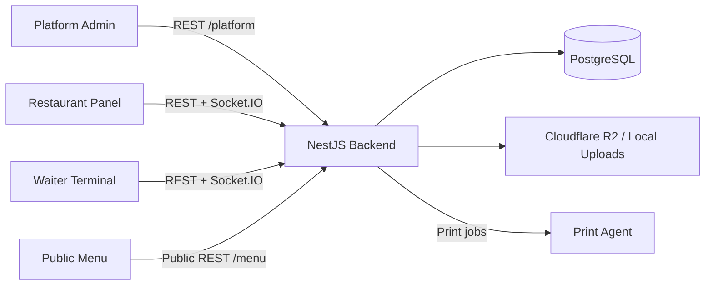
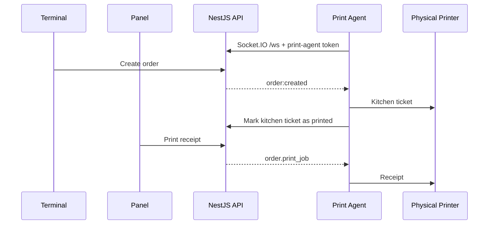

# Corder

> [English](README.md)

Corder, restoran operasyonları için geliştirdiğim çok kiracılı (multi-tenant) bir POS ve yönetim sistemidir.

Platform; restoran kurulumu, dijital menü, masa ve adisyon yönetimi, sipariş alma, kasa, stok, personel, kampanya, raporlama ve yazdırma süreçlerini kapsar.

## Teknik kapsam

Kod tabanında NestJS modülleri, TypeORM migration'ları, PostgreSQL tenant izolasyonu, JWT kimlik doğrulama ve Socket.IO ile gerçek zamanlı senkronizasyon bulunuyor. Masa oturumlarında eşzamanlı erişim pessimistic locking ile kontrol ediliyor. Backend Docker Compose ve nginx ile çalışıyor; dosyalar Cloudflare R2'de tutulabiliyor. Frontendler bağımsız Vite uygulamaları olarak Cloudflare Pages'e dağıtılabilecek şekilde ayrıldı. Mutfak ve adisyon yazdırma, bu repository içindeki Windows `print-agent` servisiyle yapılır.

## Uygulamalar


| Uygulama                   | Kullanıcı           | Açıklama                                                                 | Varsayılan port |
| -------------------------- | ------------------- | ------------------------------------------------------------------------ | --------------- |
| `corder-admin-frontend`    | Platform yöneticisi | Restoran/şube, Boss (İşletme Sahibi), terminal ve print-agent yönetimi   | `3003`          |
| `corder-boss-frontend`     | İşletme sahibi (Boss) | Çoklu şube ciro takibi, 48 granüler yetki/rol matrisi ve kullanıcı oluşturma (Mobil PWA) | `3004` |
| `corder-panel-frontend`    | Şube yöneticisi / Kasiyer | Masa, ödeme, kasa, ürün, stok, personel, kampanya ve rapor yönetimi | `3001`          |
| `corder-terminal-frontend` | Garson / terminal   | Personel seçimi, masa kilitleme, sipariş, adisyon taşıma ve fiş yazdırma | `3000`          |
| `corder-menu-frontend`     | Restoran müşterisi  | Herkese açık dijital menü, ürün arama, kampanyalar ve iletişim bilgileri | `3002`          |
| `corder-backend`           | Tüm istemciler      | REST API, Socket.IO, kimlik doğrulama, RBAC yetki motoru ve veri erişimi | `4000`          |
| `print-agent`              | Restoran POS PC     | Windows Node.js servisi: Socket.IO + HTTP sync, ESC/POS mutfak/adisyon yazdırma | —            |


## Mimari




Backend, NestJS tabanlı modüler bir monolittir:

- `PlatformModule`: Platform yöneticisi, restoran ve root admin işlemleri
- `RestaurantModule`: Masa, sipariş, kasa, stok, personel, yazıcı ve restoran ayarları
- `MenuModule`: Herkese açık dijital menü sorguları
- `OrdersGateway`: Restoran bazlı Socket.IO olayları

Restoran verileri PostgreSQL'de `restaurant_id` ile birbirinden ayrılır.

## Teknoloji yığını

### Frontend

- React 19
- TypeScript 5.7
- Vite 6
- Tailwind CSS 4
- Socket.IO Client (panel ve terminal)
- Recharts (panel)
- pnpm

### Backend

- Node.js 20
- NestJS 10
- TypeORM 0.3
- PostgreSQL 16
- Socket.IO
- JWT + Passport
- Cloudflare R2 / S3 API
- Docker Compose ve nginx

## Gereksinimler

- Node.js 20+
- pnpm
- Docker ve Docker Compose

> Bu repository henüz bir pnpm workspace değildir. Bağımlılıklar her uygulama klasöründe ayrı ayrı kurulmalıdır.

## Yerel geliştirme

### 1. Backend

```bash
cd corder-backend
cp .env.example .env
pnpm install
./start-dev.sh
```

`start-dev.sh`, geliştirme PostgreSQL servisini Docker ile başlatır ve NestJS API'yi development modunda çalıştırır.

Alternatif olarak PostgreSQL zaten çalışıyorsa:

```bash
cd corder-backend
pnpm install
pnpm run start:dev
```

API: [http://localhost:4000](http://localhost:4000)  
Health check: [http://localhost:4000/health](http://localhost:4000/health)

### 2. Frontendler

Her frontend ayrı terminalde çalıştırılmalıdır:

```bash
cd corder-terminal-frontend
printf 'VITE_API_URL=http://localhost:4000\n' > .env.local
pnpm install
pnpm run dev
```

```bash
cd corder-panel-frontend
printf 'VITE_API_URL=http://localhost:4000\n' > .env.local
pnpm install
pnpm run dev
```

```bash
cd corder-menu-frontend
printf 'VITE_API_URL=http://localhost:4000\n' > .env.local
pnpm install
pnpm run dev
```

```bash
cd corder-admin-frontend
printf 'VITE_API_URL=http://localhost:4000\n' > .env.local
pnpm install
pnpm run dev
```

Yerel adresler:

- Terminal: [http://localhost:3000](http://localhost:3000)
- Panel: [http://localhost:3001](http://localhost:3001)
- Menü: `http://localhost:3002?restaurant=RESTAURANT_SLUG`
- Platform admin: [http://localhost:3003](http://localhost:3003)

## Docker ile yerel çalıştırma

Backend iki farklı Docker kullanım senaryosu sunar.

### Seçenek A - Yalnız PostgreSQL Docker'da

Geliştirmede PostgreSQL'i container içinde, NestJS'i ise watch mode ile host üzerinde çalıştırıyorum:

```bash
cd corder-backend
cp .env.example .env
pnpm install
docker compose -f docker-compose.dev.yml up -d
pnpm run start:dev
```

`docker-compose.dev.yml` şu ayarlarla gelir:

- `postgres:16-alpine` image'ını kullanır.
- PostgreSQL'i host üzerindeki `5432` portuna açar.
- Verileri `pgdata_dev` named volume içinde kalıcı tutar.
- `pg_isready` ile container health check uygular.
- NestJS hot reload özelliğini korur.

Container durumunu ve loglarını kontrol etmek için:

```bash
docker compose -f docker-compose.dev.yml ps
docker compose -f docker-compose.dev.yml logs -f db
```

Geliştirme veritabanını durdurmak:

```bash
docker compose -f docker-compose.dev.yml down
```

Veritabanı volume'unu da silerek tamamen temiz başlamak:

```bash
docker compose -f docker-compose.dev.yml down -v
```

> `-v` mevcut yerel veritabanı verilerini kalıcı olarak siler.

### Seçenek B - Backend stack'inin tamamı Docker'da

Production topolojisini yerelde test etmek için API, nginx ve PostgreSQL birlikte ayağa kaldırılabilir:

```bash
cd corder-backend
cp .env.production.example .env
```

`.env` içindeki örnek secret ve parola değerlerini değiştirin:

```bash
openssl rand -hex 32
openssl rand -hex 32
```

Ardından stack'i build edip başlatın:

```bash
docker compose up -d --build
```

Servis durumları:

```bash
docker compose ps
docker compose logs -f api
docker compose logs -f nginx
docker compose logs -f db
```

Bu compose yapısında:

- nginx host üzerinde `80` portunu dinler.
- NestJS API yalnızca Docker network içinde `4000` portunda çalışır.
- PostgreSQL host'a açılmaz; yalnızca API container'ı erişebilir.
- PostgreSQL başlamadan API başlatılmaz; `service_healthy` koşulu kullanılır.
- Upload dosyaları `api_uploads` named volume içinde saklanır.
- PostgreSQL verileri `pgdata` named volume içinde kalıcıdır.

API'yi nginx üzerinden doğrulayın:

```bash
curl http://localhost/health
```

Stack'i durdurmak:

```bash
docker compose down
```

Container ve production benzeri yerel verileri tamamen silmek:

```bash
docker compose down -v
```

### Dockerfile yapısı

`corder-backend/Dockerfile` iki aşamalı build kullanır:

1. **Builder stage**
   - `node:20-alpine` tabanı kullanılır.
   - Corepack üzerinden pnpm etkinleştirilir.
   - Lockfile ile deterministik dependency kurulumu yapılır.
   - NestJS uygulaması `dist/` klasörüne derlenir.
2. **Runtime stage**
   - Yalnız production dependency'leri kurulur.
   - Builder stage'den sadece derlenmiş `dist/` çıktısı alınır.
   - `/app/uploads` kalıcı volume olarak tanımlanır.
   - Uygulama `node dist/main.js` ile çalışır.

Build araçları ve geliştirme dependency'leri son image'a kopyalanmaz. Runtime image yalnızca derlenmiş uygulamayı ve production dependency'lerini içerir.

Frontendlerde Dockerfile yok. Vite çıktıları statik olduğu için bunları Cloudflare Pages üzerinden dağıtmak, ayrı container çalıştırmaktan daha uygun. Yerel geliştirmede frontendler pnpm ile çalıştırılır.

## İlk kurulum akışı

1. Backend `.env` dosyasında `PLATFORM_ADMIN_EMAIL` ve `PLATFORM_ADMIN_PASSWORD` değerlerini tanımlayın.
2. Backend başladığında platform yöneticisi otomatik olarak oluşturulur.
3. Platform admin arayüzünden giriş yapın.
4. Yeni bir restoran oluşturun.
5. Restoran için root admin hesabı tanımlayın.
6. Terminal e-posta/parolasını ve gerekiyorsa print-agent tokenını ayarlayın.
7. Restoran POS bilgisayarında [`print-agent/`](print-agent/) kurup bu token ile yapılandırın; açılışta otomatik başlasın diye boot cron / zamanlanmış görev tanımlayın (aşağıdaki Yazdırma sistemi bölümüne bakın).
8. Root admin hesabıyla panelden kategori, ürün, personel, bölüm ve masaları oluşturun.
9. Terminal hesabıyla giriş yaparak sipariş akışını kullanın.
10. Dijital menüyü restoran slug'ı ile açın.

## Temel iş akışları

### Sipariş

1. Terminal restoran hesabıyla giriş yapar.
2. Garson seçilir ve gerekiyorsa PIN doğrulanır.
3. Masa, sunucu tarafındaki session-lock mekanizmasıyla kilitlenir.
4. Ürünler sepete eklenerek sipariş oluşturulur.
5. Sipariş Socket.IO üzerinden panel ve diğer terminallere bildirilir.
6. Mutfak veya fiş yazdırma işi print-agent'a gönderilir.
7. Ödeme panelden tamamlanır; masa, kasa ve tamamlanmış sipariş kayıtları güncellenir.

### Kasa ve ödeme

Sipariş ve ödeme işlemleri için açık bir kasa vardiyası gerekir. Sistem nakit, kart, yemek kartı, Multinet, indirim, bahşiş ve veresiye kayıtlarını destekler.

### Stok

Malzemeler, tedarikçiler, stok hareketleri, satın alma siparişleri ve envanter sayımları panelden yönetilir. Ürün reçeteleri JSON olarak tutulur.

## Yazdırma sistemi

Tarayıcı uygulamaları yazıcıya doğrudan bağlanmaz. Terminal ve panel yazdırma isteğini backend'e gönderir; restoranda çalışan ayrı bir print-agent işi alıp fiziksel yazıcıya iletir. Böylece USB, ağ veya Bluetooth yazıcının tarayıcı tarafından erişilebilir olması gerekmez.



### Print-agent kimliği

Her restoranın ayrı bir `print_agent_token` değeri vardır. Token platform admin arayüzünden restoran bazında oluşturulur ve print-agent'a verilir.

Agent iki kanalda aynı tokenı kullanır:

- Socket.IO bağlantısında `/ws` handshake tokenı
- HTTP fallback isteklerinde `Authorization: Bearer PRINT_AGENT_TOKEN`

Backend tokenı restoran kaydıyla eşleştirir ve agent'ı yalnızca o restoranın Socket.IO odasına alır. Print-agent tokenı uzun ömürlü bir kimlik bilgisidir; Git'e eklenmemeli ve restoranlar arasında paylaşılmamalıdır.

### Mutfak fişi

Yeni sipariş oluşturulduğunda backend `order:created` olayını restoran odasına yayınlar. Olay içinde şunlar bulunur:

- Sipariş ve masa bilgisi
- Garson adı
- Ürün, adet, fiyat ve not
- Ürün ve kategori kimlikleri

Kategori kimlikleri agent tarafında mutfak, bar veya başka bir departman yazıcısına yönlendirme yapmak için kullanılabilir.

WebSocket bağlantısı koptuğunda mutfak fişinin kaybolmaması için HTTP fallback bulunur:

```http
GET /restaurant/print-agent/pending-kitchen-orders
Authorization: Bearer PRINT_AGENT_TOKEN
```

Bu endpoint, aktif durumda olan ve `kitchen_ticket_printed_at` alanı boş kalan en eski 100 siparişi döndürür. Agent yazdırmayı tamamladıktan sonra siparişi onaylar:

```http
PATCH /restaurant/print-agent/orders/ORDER_ID/kitchen-printed
Authorization: Bearer PRINT_AGENT_TOKEN
```

Onayla birlikte `kitchen_ticket_printed_at` güncellenir ve aynı sipariş sonraki fallback sorgularında gelmez. Agent yeniden başladığında önce bekleyen siparişleri çekip ardından Socket.IO olaylarını dinleyebilir.

### Adisyon ve kasa fişi

Terminal veya panel aşağıdaki endpoint üzerinden fiş işi oluşturur:

```http
POST /restaurant/orders/print-receipt
Authorization: Bearer RESTAURANT_JWT
Content-Type: application/json
```

İki fiş modu vardır:

- `split`: Tek adisyon veya kategori bazlı çıktı. Satır notları korunur.
- `consolidated`: Masadaki aktif siparişleri tek fişte toplar. Aynı ürün ve birim fiyata sahip satırlar birleştirilir, satır notları çıkarılır.

İstek `orderId` ile tek adisyonu, `tableId` ile masadaki bütün aktif siparişleri veya doğrudan `items` ile hızlı satış satırlarını yazdırabilir. Backend toplamı ve kategori bilgilerini hazırlayıp `order.print_job` Socket.IO olayı olarak agent'a gönderir.

Bir ürün iptal edildiğinde aynı kanal üzerinden `kitchen_cancel` tipinde iş üretilir. Bu iş masa, garson, iptal eden personel, iptal nedeni ve ürün bilgilerini içerir.

### Yazıcı kayıtları

Backend'deki `restaurant_printer_configs` tablosu şu bilgileri tutar:

- Yazıcı adı ve tipi (`thermal`, `kitchen`, `bar` gibi)
- Bağlantı türü (`usb`, `network`, `bluetooth`)
- Ağ yazıcıları için IP adresi ve port
- Departman
- Durum (`online`, `offline`, `error`)
- Kağıt genişliği, varsayılan `80`
- Otomatik kesme ayarı

Bu kayıtlar yazıcı envanteri ve yönlendirme ayarları içindir. Fiziksel yazdırmayı NestJS container'ı değil, restoran ağındaki print-agent yapar.

### Print agent uygulaması (`print-agent/`)

Restoran tarafındaki agent bu repository içinde [`print-agent/`](print-agent/) altında yer alır. Genellikle Windows 10 POS bilgisayarında çalışan bir Node.js servisidir; tarayıcı/PWA kapalı olsa bile backend bağlantısını sürdürür.

**Ne yapar**

- `AGENT_TOKEN` (restoran `print_agent_token`) ile Socket.IO `/ws` kanalına bağlanır
- `order:created` (mutfak fişi) ve `order.print_job` (adisyon / iptal işleri) olaylarını dinler
- ESC/POS fiş üretir; USB (Windows spooler RAW) veya ağ (`host:port`) termal yazıcıya gönderir
- Başarısız işleri diske kuyruklar ve yeniden dener; WebSocket kopunca HTTP ile bekleyen mutfak siparişlerini çeker
- Kategoriye göre bir siparişi birden fazla yazıcıya bölebilir (`PRINT_CATEGORY_ROUTES` / `PRINT_CATEGORY_NETWORK`)

**Hızlı kurulum**

```bash
cd print-agent
npm install
copy .env.example .env
```

En az şunları doldurun:

- `BACKEND_WS_URL` — API origin (ör. `https://api.example.com`)
- `BACKEND_SOCKET_PATH` — genelde `/ws`
- `AGENT_TOKEN` — platform admin restoran ekranındaki print-agent tokenı
- `RESTAURANT_ID` — restoran id (`*` yerine gerçek id tercih edilir)
- `PRINTER_MODE` — `command` (USB / Windows yazıcı adı) veya `network_raw` (TCP 9100)
- `PRINTER_NAME` — `command` modunda Windows yazıcı adıyla birebir aynı

Başlatma:

```bash
npm start
```

Windows USB için `PRINT_COMMAND`, spooler RAW modunda `scripts/send-raw-printer.ps1` çalıştırır. Mümkünse Ethernet + `PRINTER_MODE=network_raw` daha güvenilir teslimat sağlar.

**Önerilen: bilgisayar açılışında otomatik başlatma (cron / zamanlanmış görev)**

Her yeniden başlatmadan sonra agent'ı elle çalıştırmayın. POS bilgisayarında print-agent'ı açılışta başlayacak şekilde tanımlayın:

- **Linux / macOS:** `print-agent` dizinine `cd` edip `npm start` (veya `node src/index.js`) çalıştıran cron `@reboot`
- **Windows:** Task Scheduler “At startup” / “At log on” (Windows'ta boot cron eşdeğeri); NSSM servisi isteğe bağlı alternatif

Örnek crontab / Task Scheduler komutları [`print-agent/README.md`](print-agent/README.md) ([Türkçe](print-agent/README.tr.md)) içinde.

### Çalışma notları

- nginx `/ws` için WebSocket upgrade header'larını backend'e iletir.
- Agent bağlantı sırasında JWT yerine print-agent tokenıyla doğrulanabilir.
- Mutfak siparişlerinde veritabanı tabanlı fallback ve yazdırıldı onayı vardır.
- Adisyon ve iptal işleri şu anda Socket.IO üzerinden gönderilir; mutfak siparişlerindeki HTTP fallback bu iş tipleri için uygulanmaz.
- Aynı agent birden fazla fiziksel yazıcıya kategori veya departman bazında yönlendirme yapabilir.
- Elektrik kesintisi veya OS yeniden başlatmasından sonra agent'ın geri gelmesi için boot cron / zamanlanmış görev tercih edin.

## Kimlik doğrulama

Sistemde üç temel kimlik türü bulunur:

- Platform yöneticisi JWT'si
- Restoran root admin / terminal JWT'si
- Print-agent bearer tokenı

JWT anahtarları ve başlangıç hesapları backend ortam değişkenleriyle yönetilir. Production ortamında örnek veya varsayılan secret değerleri kullanılmamalıdır.

## Ortam değişkenleri

Backend için temel değişkenler:

```dotenv
NODE_ENV=development
PORT=4000

DB_HOST=localhost
DB_PORT=5432
DB_USERNAME=corder
DB_PASSWORD=corder_secret
DB_NAME=corder

JWT_SECRET=change-me
JWT_EXPIRES_IN=7d
PLATFORM_JWT_SECRET=change-me-too
PLATFORM_ADMIN_EMAIL=admin@example.com
PLATFORM_ADMIN_PASSWORD=change-me

CORS_ORIGIN=http://localhost:3000,http://localhost:3001,http://localhost:3002,http://localhost:3003
```

Dosya yüklemelerini Cloudflare R2 üzerinde tutmak için ayrıca şu değişkenler kullanılabilir:

```dotenv
R2_ACCOUNT_ID=
R2_ACCESS_KEY_ID=
R2_SECRET_ACCESS_KEY=
R2_BUCKET_NAME=
R2_PUBLIC_BASE_URL=
```

Frontendlerin tamamı backend adresini build-time değişkeni olarak alır:

```dotenv
VITE_API_URL=http://localhost:4000
```

Tüm seçenekler için:

- `corder-backend/.env.example`
- `corder-backend/.env.production.example`
- Frontendlerdeki `.env.production.example` dosyaları

## Cloudflare R2 Object Storage

Panelden yüklenen ürün ve kampanya görselleri Cloudflare R2 üzerinde tutulabilir. Backend, AWS SDK for JavaScript ile R2'nin S3 uyumlu API'sini kullanır.

### Neden R2?

- S3 uyumlu API sayesinde standart AWS SDK kullanımı
- Görsellerin uygulama sunucusundan bağımsız saklanması
- Cloudflare custom domain ve CDN cache desteği
- Backend container'ı yeniden oluşturulduğunda dosya kaybı yaşanmaması
- Tenant bazlı object key yapısı
- Public görseller için düşük operasyon maliyeti

### Object key yapısı

Yüklenen dosyalar restoran slug'ına göre ayrılır:

```text
RESTAURANT_SLUG/menu/TIMESTAMP-RANDOM_SUFFIX.webp
```

Örnek:

```text
demo-restoran/menu/1784155200000-a1b2c3d4.webp
```

Backend:

- Yalnız `jpeg`, `png`, `gif` ve `webp` kabul eder.
- Dosya boyutunu 5 MB ile sınırlar.
- Dosyayı bellekte alıp doğrudan R2'ye gönderir.
- Object üzerinde `Content-Type` bilgisini korur.
- `Cache-Control: public, max-age=31536000, immutable` ekler.
- Başarılı upload sonunda public object URL'sini döndürür.

Dosya isimleri benzersiz üretildiği için uzun süreli immutable cache güvenle kullanılabilir.

### 1. R2 bucket oluşturma

Cloudflare Dashboard üzerinden:

1. **Storage & Databases > R2 Object Storage** bölümünü açın.
2. **Create bucket** seçeneğine tıklayın.
3. Örneğin `corder-uploads` adında bir bucket oluşturun.
4. İhtiyaca uygun location ve storage class seçin.

Wrangler ile alternatif kurulum:

```bash
npx wrangler login
npx wrangler r2 bucket create corder-uploads
npx wrangler r2 bucket list
```

### 2. R2 API token oluşturma

1. R2 Overview ekranında **Manage API Tokens** bölümüne gidin.
2. **Create Account API token** veya **Create User API token** seçin.
3. Yetki olarak **Object Read & Write** verin.
4. Tokenı tüm bucket'lar yerine yalnızca `corder-uploads` bucket'ıyla sınırlandırın.
5. Oluşturulan `Access Key ID` ve `Secret Access Key` değerlerini güvenli bir yere kaydedin.

Secret key daha sonra tekrar görüntülenemeyebilir. Bu değerler frontend environment değişkenlerine veya Git repository'ye eklenmemelidir.

R2 S3 endpoint formatı:

```text
https://ACCOUNT_ID.r2.cloudflarestorage.com
```

Backend endpoint'i `R2_ACCOUNT_ID` üzerinden otomatik oluşturur.

### 3. Public custom domain bağlama

Production'da `r2.dev` development URL'si yerine custom domain kullanılmalı:

1. R2 bucket içindeki **Settings** sekmesini açın.
2. **Public access > Custom Domains > Connect Domain** seçeneğine gidin.
3. Örneğin `cdn.example.com` domainini bağlayın.
4. Cloudflare'ın oluşturacağı DNS kaydını onaylayın.
5. Bucket erişimini bu URL üzerinden test edin.

Örnek:

```dotenv
R2_PUBLIC_BASE_URL=https://cdn.example.com
```

Cloudflare Cache, WAF, access control ve bot management özellikleri custom domain üzerinden kullanılabilir. `r2.dev` adresi geliştirme ve test içindir.

### 4. Backend environment değişkenleri

Sunucudaki `corder-backend/.env` dosyasına:

```dotenv
R2_ACCOUNT_ID=cloudflare-account-id
R2_ACCESS_KEY_ID=r2-access-key-id
R2_SECRET_ACCESS_KEY=r2-secret-access-key
R2_BUCKET_NAME=corder-uploads
R2_PUBLIC_BASE_URL=https://cdn.example.com
```

Compose dosyası bu değişkenleri API container'ına aktarır. Container loglarında aşağıdaki mesaj görülmelidir:

```text
R2 upload enabled (bucket=corder-uploads)
```

Beş değerden biri eksikse R2 devre dışı kalır ve backend yerel `/uploads` klasörüne geri döner:

```text
R2 upload disabled ... Falling back to local /uploads
```

Docker kullanımında yerel upload'lar `api_uploads` volume'unda saklanır. Production'da R2, geliştirmede ise local fallback kullanılabilir.

### 5. R2 cache ayarları

Yeni yüklenen object'ler cache header ile oluşturulur. Daha önce yüklenmiş object'lerin header'larını güncellemek için:

```bash
cd corder-backend
node --env-file=.env scripts/r2-set-cache-headers.mjs
```

Script:

- Bucket içindeki bütün object'leri pagination ile listeler.
- Her object'in mevcut `Content-Type` değerini okur.
- Object'i kendi üzerine kopyalayarak metadata'yı yeniler.
- Bir yıllık immutable cache header uygular.

Custom domain üzerinde tüm dosya türlerinin cache edilmesi isteniyorsa Cloudflare Cache Rules içinde ilgili hostname için **Cache Everything** kuralı tanımlanabilir. Değişiklikler görünmüyorsa ilgili hostname/object için cache purge uygulanmalıdır.

### R2 CORS notu

Tarayıcı R2'ye doğrudan upload yapmıyor. Dosya önce kimliği doğrulanmış NestJS endpoint'ine geliyor, ardından backend tarafından R2'ye yazılıyor. Bu akışta R2 CORS ayarı gerekmiyor.

İleride presigned URL ile doğrudan browser upload uygulanırsa bucket CORS politikası yalnızca bilinen panel originlerine izin verecek şekilde sınırlandırılmalıdır.

## Veritabanı

Production şeması TypeORM migration'larıyla yönetilir ve migration'lar varsayılan olarak backend başlangıcında otomatik çalıştırılır (`migrationsTransactionMode: 'each'`). `SKIP_MIGRATIONS_ON_START=true` ayarı bu davranışı devre dışı bırakır.

Migration dosyaları `corder-backend/src/migrations` altındadır. Manuel migration çalıştırmak veya geri almak için:

```bash
cd corder-backend
pnpm run build
pnpm run migration:run
# son migration'ı geri almak için:
pnpm run migration:revert
```

Ayrıntılı veritabanı, indeks ve yedekleme notları için [DATABASE.md](corder-backend/docs/DATABASE.md) dosyasına bakın.

## Build

Her paket kendi klasöründe build edilir:

```bash
pnpm run build
```

Frontend çıktıları `dist/`, backend çıktısı ise `dist/` klasörüne yazılır.

## Sunucuda Docker ile production kurulumu

### 1. Sunucu hazırlığı

Sunucuda şunlar bulunmalıdır:

- Git
- Docker Engine
- Docker Compose plugin
- Domain/DNS erişimi
- En azından Docker image'ları ve PostgreSQL verisi için yeterli disk

Docker kurulumunu dağıtımınızın resmi Docker Engine dokümantasyonuna göre yapın. Kurulumu doğrulayın:

```bash
docker --version
docker compose version
docker run --rm hello-world
```

### 2. Repository'yi sunucuya alın

Örnek dizin:

```bash
sudo mkdir -p /opt/corder
sudo chown "$USER":"$USER" /opt/corder
git clone YOUR_GIT_REPOSITORY_URL /opt/corder
cd /opt/corder/corder-backend
```

### 3. Production environment oluşturun

```bash
cp .env.production.example .env
chmod 600 .env
```

Güçlü secret üretin:

```bash
openssl rand -hex 32
openssl rand -hex 32
openssl rand -base64 36
```

`.env` içinde en azından şu alanları production değerleriyle doldurun:

- `DB_PASSWORD`
- `JWT_SECRET`
- `PLATFORM_JWT_SECRET`
- `PLATFORM_ADMIN_EMAIL`
- `PLATFORM_ADMIN_PASSWORD`
- `CORS_ORIGIN`
- Kullanılacaksa bütün `R2_*` değerleri

Production CORS örneği:

```dotenv
CORS_ORIGIN=https://panel.example.com,https://terminal.example.com,https://menu.example.com,https://admin.example.com
```

### 4. Stack'i başlatın

```bash
cd /opt/corder/corder-backend
docker compose build --pull
docker compose up -d --remove-orphans
docker compose ps
```

İlk başlangıç loglarını kontrol edin:

```bash
docker compose logs -f api
```

Production ortamında TypeORM migration'ları API başlangıcında otomatik çalışır. Deployment öncesinde veritabanı yedeği alınmalı ve migration tamamlanmadan trafik açılmamalıdır.

Health check:

```bash
curl --fail http://127.0.0.1/health
```

Güncelleme:

```bash
cd /opt/corder
git fetch origin main
git checkout main
git pull --ff-only origin main
cd corder-backend
docker compose build --pull
docker compose up -d --remove-orphans
```

### 5. DNS, Cloudflare proxy ve TLS

Mevcut nginx yapılandırması `api.example.com` hostname'ini ve host üzerinde yalnızca HTTP `80` portunu dinler. Production için:

1. Cloudflare DNS'te API subdomaini oluşturun.
2. A/AAAA kaydını sunucu IP'sine yönlendirin.
3. Cloudflare proxy'yi etkinleştirin.
4. API ve `/ws` trafiğinin geçtiğini doğrulayın.
5. Origin tarafında TLS ekleyin ve Cloudflare SSL/TLS modunu **Full (strict)** kullanın.

Mevcut repository origin üzerinde `443`/TLS yapılandırması içermediği için production öncesinde nginx'e Cloudflare Origin Certificate, Let's Encrypt veya TLS sonlandıran başka bir reverse proxy/load balancer eklenmelidir. Cloudflare **Flexible** modu güvenli production çözümü olarak önerilmez; Cloudflare ile origin arasındaki trafiği şifrelemez.

WebSocket için nginx:

- `Upgrade` ve `Connection` header'larını geçirir.
- `/ws` isteklerini API container'ına yönlendirir.
- Uzun bağlantılar için `proxy_read_timeout 86400` kullanır.

## CI/CD pipeline

Mevcut backend pipeline'ı:

```text
push main
  -> GitHub Actions
  -> appleboy/ssh-action
  -> production sunucusu
  -> git fetch/reset
  -> docker compose build --pull
  -> docker compose up -d
  -> eski image'ları prune et
```

Workflow:

- `main` dalına push ile veya manuel `workflow_dispatch` ile tetiklenir.
- Aynı anda tek deployment çalıştırır.
- Yeni deployment başladığında devam eden eski deployment'ı iptal eder.
- GitHub-hosted Ubuntu runner kullanır.
- SSH private key ile sunucuya bağlanır.
- Hata durumunda scripti durdurur.

Gerekli GitHub repository ayarları:

### Variables

```text
DEPLOY_HOST
DEPLOY_USER
DEPLOY_REPO_ROOT
```

### Secrets

```text
DEPLOY_SSH_KEY
```

GitHub Actions workflow'ları monorepo kökündeki `.github/workflows/ci.yml` ve `.github/workflows/deploy.yml` altındadır. Deploy pipeline'ı SSH ile sunucuya bağlanmadan önce TypeScript tip kontrolü, birim testleri (`pnpm test`) ve production build adımlarını doğrular; sunucuda `corder-backend/deploy/remote-deploy.sh` betiği deploy öncesi otomatik `pg_dump` yedeği alır, `/health/ready` kontrolünü bekler ve hata durumunda önceki commit'e otomatik rollback yapar.

## Cloudflare Pages ile frontend deployment

Dört frontend de statik Vite SPA'dır. Her biri ayrı bir Cloudflare Pages projesi olarak dağıtılır:

| Pages projesi | Root directory | Build command | Output directory | Önerilen domain |
| --- | --- | --- | --- | --- |
| Corder Admin | `corder-admin-frontend` | `pnpm run build` | `dist` | `admin.example.com` |
| Corder Panel | `corder-panel-frontend` | `pnpm run build` | `dist` | `panel.example.com` |
| Corder Terminal | `corder-terminal-frontend` | `pnpm run build` | `dist` | `terminal.example.com` |
| Corder Menu | `corder-menu-frontend` | `pnpm run build` | `dist` | `menu.example.com` |

### Pages projesi oluşturma

Her frontend için:

1. Cloudflare Dashboard'da **Workers & Pages** bölümüne gidin.
2. **Create application > Pages > Import an existing Git repository** seçin.
3. Bu monorepo'nun GitHub repository'sini bağlayın.
4. Framework preset olarak **React (Vite)** seçin.
5. İlgili frontend klasörünü **Root directory (advanced)** olarak ayarlayın.
6. Build command alanına `pnpm run build` yazın.
7. Build output directory alanını `dist` yapın.
8. Production branch olarak `main` seçin.
9. Environment variables bölümüne production API URL'sini ekleyin:

```dotenv
VITE_API_URL=https://api.example.com
```

10. İlk deployment'ı başlatın.

Cloudflare Pages dependency kurulumunu lockfile üzerinden algılar. Gerekirse Pages environment variables altında Node sürümünü proje standardıyla uyumlu olacak şekilde sabitleyin:

```dotenv
NODE_VERSION=20
```

Her frontend kendi `pnpm-lock.yaml` dosyasına sahip olduğu için root directory ayarı zorunludur.

### Monorepo build watch paths

Gereksiz build almamak için her Pages projesine kendi klasörü build watch path olarak verilir:

```text
corder-admin-frontend/**
corder-panel-frontend/**
corder-terminal-frontend/**
corder-menu-frontend/**
```

Her proje yalnızca kendi path'ini izlemelidir. Ortak bir package klasörü eklenirse ilgili ortak path bütün bağımlı Pages projelerine eklenmelidir.

### Preview deployments

Cloudflare Pages, production branch dışındaki branch ve pull request'ler için preview URL üretebilir. Önerilen akış:

1. Feature branch açılır.
2. Pull request oluşturulur.
3. Pages ilgili frontend için preview deployment üretir.
4. API gerekiyorsa preview origin'i backend `CORS_ORIGIN` listesine kontrollü biçimde eklenir.
5. İnceleme tamamlandıktan sonra `main` merge'i production deployment'ı tetikler.

Backend CORS yapılandırması wildcard preview domainleri doğrudan desteklemiyor; çok sayıda dinamik preview URL kullanılacaksa origin doğrulama stratejisi ayrıca tasarlanmalıdır.

### Custom domain bağlama

Her Pages projesinde:

1. **Custom domains > Set up a custom domain** seçeneğine gidin.
2. İlgili subdomaini girin.
3. Cloudflare zone aynı hesaptaysa DNS kaydı otomatik oluşturulur.
4. SSL sertifikasının aktif olmasını bekleyin.
5. Domaini backend `CORS_ORIGIN` değerine ekleyin.
6. Frontend deployment'ını yeniden çalıştırın.

Önerilen domain yapısı:

```text
api.example.com       -> Docker/NestJS backend
admin.example.com     -> Cloudflare Pages
panel.example.com     -> Cloudflare Pages
terminal.example.com  -> Cloudflare Pages
menu.example.com      -> Cloudflare Pages
cdn.example.com       -> Cloudflare R2 custom domain
```

### SPA route davranışı

Cloudflare Pages, build çıktısının kökünde `404.html` bulunmadığında React gibi uygulamaları otomatik olarak SPA kabul eder ve bilinmeyen yolları `index.html` üzerinden sunar. Admin uygulamasındaki `/login` ve `/dashboard/*` gibi React Router adresleri bu davranıştan yararlanır.

Mevcut uygulamalarda ek `_redirects` dosyası gerekmiyor. İleride output içine kök `404.html` eklenirse SPA fallback davranışı tekrar kontrol edilmelidir.

### Pages cache ve environment notları

- `VITE_*` değişkenleri runtime secret değildir; build sırasında JavaScript bundle içine gömülür.
- `VITE_API_URL` içinde gizli bilgi tutulmamalıdır.
- Production ve Preview ortamları için farklı API URL'leri tanımlanabilir.
- Hash'li Vite asset'leri uzun süreli cache için uygundur.
- `index.html` güncel deployment'ın hızlı alınabilmesi için kısa cache davranışında kalmalıdır.
- Cloudflare Pages otomatik TLS, CDN dağıtımı, immutable deployment ve rollback imkânı sağlar.

## Ölçekleme ve Operasyonel Notlar

- **Health ve Readiness Kontrolleri**: `GET /health` ve `GET /health/ready` uç noktaları PostgreSQL bağlantısını (`SELECT 1`) doğrular; `GET /health/live` ise hafif süreç canlılık kontrolü sunar.
- **Socket.IO ve Rate Limiter Topolojisi**: Varsayılan Docker Compose kurulumu `nginx` arkasında tek bir `api` container kopyası çalıştırır. Socket.IO oda durumu (`/ws`) ve `LoginRateLimiterService` bellekte tutulduğundan, birden fazla `api` kopyasına yatay ölçekleme yapılacaksa `@socket.io/redis-adapter` ve ortak bir Redis deposu kullanılmalıdır.

## Lisans

Bu proje [MIT Lisansı](LICENSE) ile lisanslanmıştır.
